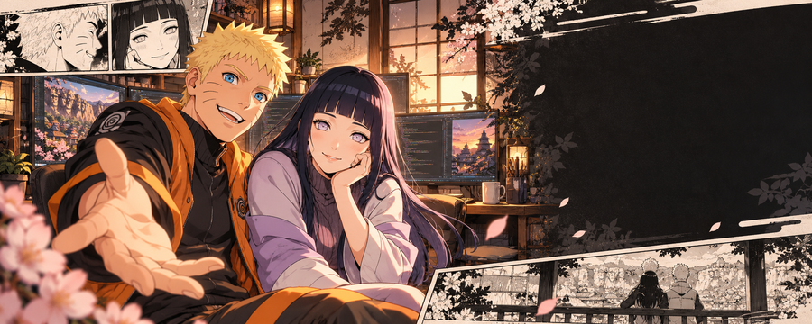
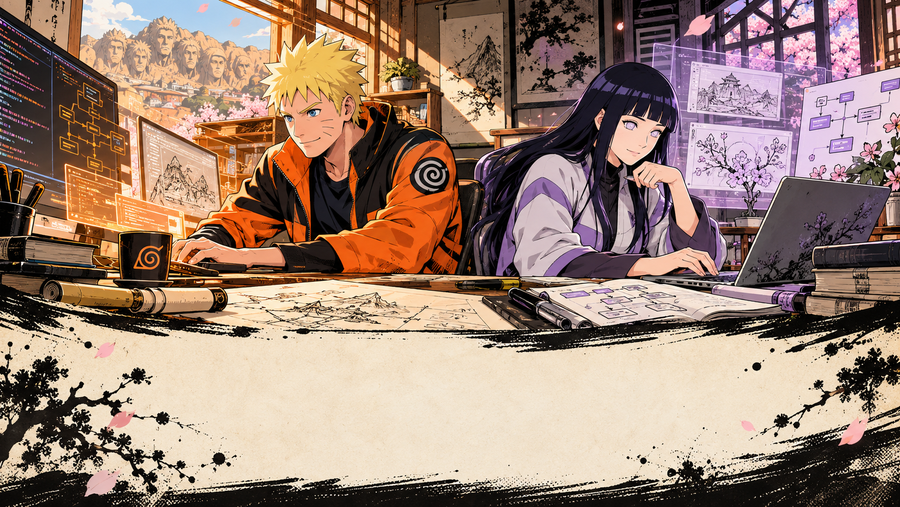
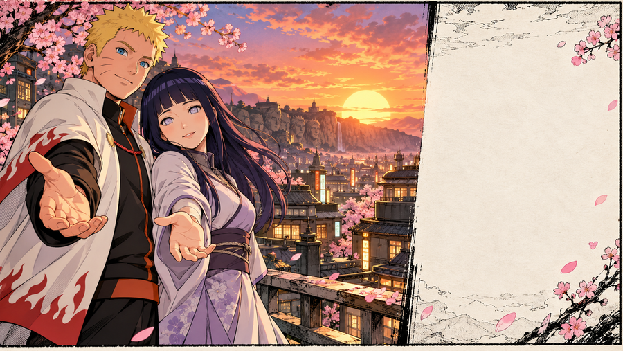

<div align="center">

<a href="https://dipc-ochre.vercel.app">
  
</a>

# ARYAN KUMAR

### Builder of interactive web experiences, AI automation, bots, and games.

*A developer journey told like a manga chapter — powered by determination, thoughtful craft, and things that actually ship.*

<a href="https://dipc-ochre.vercel.app"></a>
<a href="https://github.com/Aryan170911?tab=repositories"></a>
<a href="https://dev.to/aryan170911"></a>


</div>

## CHAPTER 01 · THE JOURNEY


I am **Aryan Kumar**, the builder behind **DIPC**. Like every worthwhile story, mine is still being written: one ambitious interface, one automation, and one strange experiment at a time.

Naruto's determination and Hinata's quiet strength capture the way I want to build—**keep moving, care about the details, and create things that help people.**

> **My ninja way:** turn imagination into software people remember and can actually use.

<div align="center">
  
</div>

## CHAPTER 02 · TRAINING RECORD



```text
NINJUTSU // FRONTEND    Next.js · React · TypeScript · JavaScript · Tailwind CSS
TAIJUTSU // MOTION      Three.js · React Three Fiber · GSAP · Framer Motion
GENJUTSU // AUTOMATION  Python · Node.js · REST APIs · Telegram Bot API
CHAKRA   // CRAFT       Responsive UI · Accessibility · Performance · Storytelling
```

<picture>
  <source media="(max-width: 600px)" srcset="./assets/mission-control-mobile.svg" />
  
</picture>

<div align="center">
  
</div>

## CHAPTER 03 · S-RANK MISSIONS

### `MISSION 01` · [DIPC — Digital India Promotion Company](https://github.com/Aryan170911/dipc)

> **The flagship mission:** a production-grade company experience built to turn attention into conversations.

Next.js and TypeScript power a bilingual interface with WebGL visuals, scroll choreography, live GitHub data, an AI sales assistant, and graceful fallbacks for lower-powered devices.

**Techniques:** `Next.js` · `React` · `TypeScript` · `Three.js` · `GSAP` · `Tailwind CSS`

[**ENTER THE LIVE EXPERIENCE ↗**](https://dipc-ochre.vercel.app) · [**READ THE SOURCE SCROLL ↗**](https://github.com/Aryan170911/dipc)

---

### `MISSION 02` · [The Dentist](https://github.com/Aryan170911/the-dentist)

> **The precision mission:** a clinic website designed to move visitors from discovery to booking.

Responsive motion and direct WhatsApp booking give patients at The Dentist, Khemnichak Patna, a clear path to action.

**Techniques:** `JavaScript` · `HTML` · `CSS` · `Motion Design`

[**OPEN THE MISSION ↗**](https://github.com/Aryan170911/the-dentist)

---

### `MISSION 03` · [Mathrubhumi Enterprises](https://github.com/Aryan170911/Mathrubhumi-Enterprises)

> **The industry mission:** an interactive corporate experience for steel engineering and fabrication.

Industrial clarity, responsive motion, project storytelling, and focused lead capture support a business serving India and Nepal.

**Techniques:** `HTML` · `Tailwind CSS` · `JavaScript` · `GSAP`

[**OPEN THE MISSION ↗**](https://github.com/Aryan170911/Mathrubhumi-Enterprises)

---

### `MISSION 04` · [Portfolio Demos](https://github.com/Aryan170911/portfolio-demos)

> **The experimentation mission:** a laboratory for interactive frontend concepts.

Clinic, restaurant, chatbot, and portfolio prototypes explore how motion and tiny interface decisions change a product's character.

**Techniques:** `React` · `Vite` · `JavaScript` · `Tailwind CSS`

[**ENTER THE LABORATORY ↗**](https://github.com/Aryan170911/portfolio-demos)

<div align="center">
  
</div>

## FINAL CHAPTER · LET'S BUILD SOMETHING LEGENDARY

<a href="https://dipc-ochre.vercel.app">
  
</a>

<div align="center">

### Your idea could be the next mission.

**If it deserves more than an ordinary interface, let's give it a story people remember.**

<a href="https://dipc-ochre.vercel.app"></a>

<sub>DIPC // BUILDING IN PUBLIC // THE NEXT CHAPTER STARTS HERE</sub>

<br /><br />

<sub>Unofficial fan-made profile artwork. Naruto and related characters belong to their respective rights holders.</sub>

</div>

