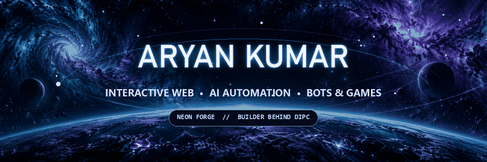
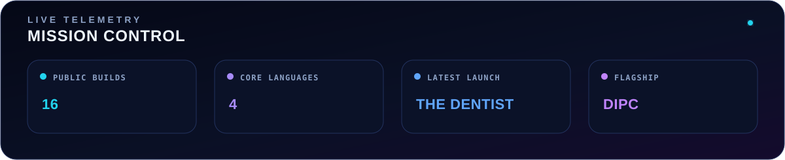

<div align="center">

<a href="https://dipc-ochre.vercel.app">
  
</a>

### I don't just ship pages. I build digital worlds people remember.

<a href="https://dipc-ochre.vercel.app"></a>
<a href="https://github.com/Aryan170911?tab=repositories"></a>
<a href="https://dev.to/aryan170911"></a>

</div>

## `> identity`

I'm **Aryan Kumar**, the builder behind **DIPC**. I combine engineering and visual storytelling to create immersive websites, practical AI automation, Telegram bots, and game systems with personality.

> **My north star:** make technology feel less like a tool and more like an experience.

<picture>
  <source media="(max-width: 600px)" srcset="./assets/mission-control-mobile.svg" />
  
</picture>

## `> flagship_missions`

### `01` · [DIPC — Digital India Promotion Company](https://github.com/Aryan170911/dipc)

**A production-grade company experience built to turn attention into conversations.**

Next.js and TypeScript power a bilingual interface with WebGL visuals, scroll choreography, live GitHub data, an AI sales assistant, and graceful performance fallbacks for lower-powered devices.

**Stack:** `Next.js` · `React` · `TypeScript` · `Three.js` · `GSAP` · `Tailwind CSS`

[**Launch the live experience ↗**](https://dipc-ochre.vercel.app) · [**Explore the source ↗**](https://github.com/Aryan170911/dipc)

---

### `02` · [The Dentist](https://github.com/Aryan170911/the-dentist)

**A focused clinic website designed to move visitors from discovery to booking.**

Animated interactions, responsive presentation, and direct WhatsApp booking create a clear path for patients at The Dentist, Khemnichak Patna.

**Stack:** `JavaScript` · `HTML` · `CSS` · `Motion Design`

[**Explore the project ↗**](https://github.com/Aryan170911/the-dentist)

---

### `03` · [Mathrubhumi Enterprises](https://github.com/Aryan170911/Mathrubhumi-Enterprises)

**An interactive corporate experience for steel engineering and fabrication.**

The site pairs industrial clarity with responsive motion, project storytelling, and focused lead capture for a business serving India and Nepal.

**Stack:** `HTML` · `Tailwind CSS` · `JavaScript` · `GSAP`

[**Explore the project ↗**](https://github.com/Aryan170911/Mathrubhumi-Enterprises)

---

### `04` · [Portfolio Demos](https://github.com/Aryan170911/portfolio-demos)

**A laboratory for interactive frontend concepts.**

Reusable experiments spanning clinic, restaurant, chatbot, and portfolio experiences—built to explore how motion and interface details shape a product's character.

**Stack:** `React` · `Vite` · `JavaScript` · `Tailwind CSS`

[**Enter the laboratory ↗**](https://github.com/Aryan170911/portfolio-demos)

## `> systems_online`

```text
FRONTEND     Next.js · React · TypeScript · JavaScript · Tailwind CSS
MOTION       Three.js · React Three Fiber · GSAP · Framer Motion
AUTOMATION   Python · Node.js · REST APIs · Telegram Bot API
CRAFT        Responsive UI · Accessibility · Performance · Storytelling
```

## `> community_signal`

- 🌌 Building ambitious digital experiences through **DIPC**
- 🍂 Registered for [**Hacktoberfest 2026**](https://hacktoberfest.com)
- 📝 Connected with the [**DEV Community**](https://dev.to/aryan170911)
- 🤝 Open to collaborations where design, automation, and imagination overlap

## `> open_channel`

<div align="center">

### Have an idea that deserves more than an ordinary interface?

**Let's turn it into something people want to explore.**

<a href="https://dipc-ochre.vercel.app"></a>

<sub>NEON FORGE // DIPC // BUILDING IN PUBLIC</sub>

</div>
